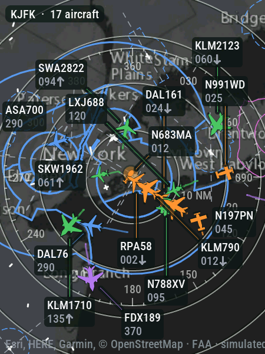
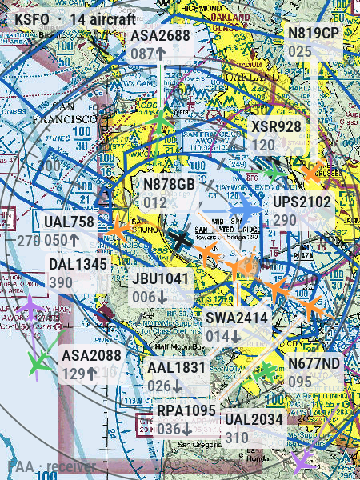
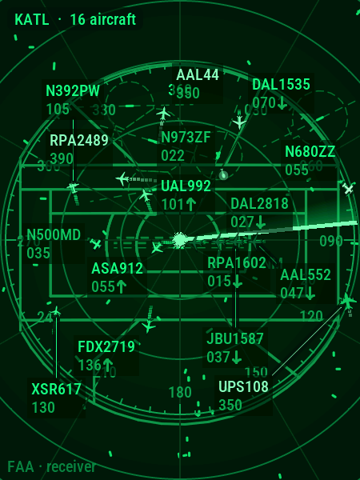
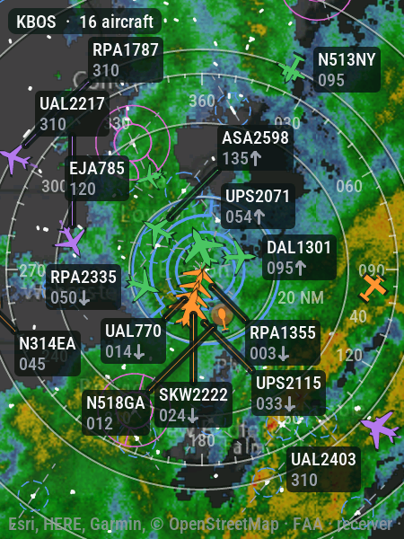

# esp-skyscope

Live aircraft tracking on a small, self-contained ESP32 touch screen. The screen fetches traffic from a public ADS-B
exchange and map tiles from public tile servers, and decodes and draws everything itself: no computer, no app.

<p>




</p>

More pictures, each map and page with a word on it: [docs/screens.md](docs/screens.md).

## What it does

- **Maps**: a radar scope drawn on the screen itself, Esri's gray streets, OpenStreetMap, satellite imagery, the USGS
  topographic map, the FAA's VFR sectional and IFR low and high charts, or a tile server of your own. Every map can be
  drawn dark or light.
- **Airspace** (United States): the FAA's Class B, C and D outlines and runways, drawn as a controller's scope draws
  them.
- **Aircraft** from adsb.fi or adsb.lol, a receiver of your own (readsb, tar1090, dump1090-fa), or on the P4 board an
  RTL-SDR stick plugged into the screen. Each plane is drawn as what it is (airliner, helicopter, glider and so on),
  colored by altitude, with labels up to a controller's full data block.
- **Follow a plane** anywhere in the world by its registration, callsign or flight number. The map moves with it, and
  over an ocean the screen shows where it is likely to be until it is heard again.
- **Aviation weather**: the nearest station's METAR, TAF and MOS, the SIGMETs, G-AIRMETs and pilot reports nearby, and
  the NEXRAD radar over any map.
- **On the glass**: tap a plane for its card, pinch to zoom, swipe to change the map, long-press for a menu with every
  setting. The screen can sleep at night.
- **A map card**: a microSD card keeps the tiles, so maps come back without downloading them again, and the FAA charts
  can be downloaded ahead for use with a slow network or none.
- **Updates itself** from the project's releases, when you press Install.

How each of these works on the glass: [docs/using.md](docs/using.md).

## Hardware

| Board | File |
|---|---|
| Waveshare ESP32-S3-Touch-AMOLED-2.41 (Rev 2.0) | `boards/waveshare-amoled-241.yaml` (the default) |
| Waveshare ESP32-S3-Touch-LCD-2.8B (Rev 1.1, 480 × 640) | `boards/waveshare-lcd-28b.yaml` |
| Waveshare ESP32-P4-WIFI6-Touch-LCD-4C (round, 720 × 720) | `boards/waveshare-p4-lcd-4c.yaml` |

Notes on each board, the P4's radio, the map card's wiring, and adding a board: [docs/hardware.md](docs/hardware.md).

## Install

You need [ESPHome](https://esphome.io) 2026.9 or newer (releases are built with the version in the `Makefile`, which
`make firmware-esphome` installs).

```sh
git clone https://github.com/dath1974/esp-skyscope
cd esp-skyscope
esphome run skyscope.yaml          # over USB the first time; add -s board <name> for another board
```

Later builds can go over Wi-Fi: `make firmware-flash DEVICE=<the screen's address>` (with `BOARD=<name>` for another
board).

## First start

1. The screen shows **Set up Wi-Fi**. Press **Choose a network here**, pick your network and type its password on the
   screen's keyboard. Or join the Wi-Fi network **Skyscope Setup** from a phone (a page opens, or go to
   `http://192.168.4.1`), or use Improv from [ESPHome Web](https://web.esphome.io) over USB.
2. The screen joins your network and opens its menu, with its address at the top. Set it up there, or open that
   address in a browser on the same network.
3. Search for a place (an airport, a town) or enter its latitude and longitude, choose a range and a map, and press
   **Save**. The map and the traffic appear within a few seconds.

Every setting is on the web page and in the menu (a long press on the map), and the screen keeps them across restarts
and updates. Tap the status bar at the top to see the screen's address.

## Updates

Every six hours the screen checks for a new release for its board. Its web page shows it under **Firmware**, with
**Install** and **Check now**. Nothing installs without being asked. Installing takes a minute or two and keeps the
settings, and a download that fails changes nothing.

A build of your own is offered the releases too. To leave them out, remove the `update:` block and the `skyscope:`
block's `update_id` from `skyscope.yaml`.

## The web page and API

The screen serves its settings page at `/` and a small JSON API beside it, for example:

```sh
curl -X POST http://<screen>/api/settings -H 'Content-Type: application/json' \
  -d '{"lat": 51.4700, "lon": -0.4543, "range_nm": 15, "map": "dark_gray"}'
```

Every request is listed in [docs/api.md](docs/api.md). The page and the API are open to anyone on your network, as an
ESPHome device's own web server is.

## Data sources

Everything the screen shows comes from free public services. Please keep to their terms; the defaults do.

| Source | What | Terms |
|---|---|---|
| [adsb.fi](https://adsb.fi) | aircraft (the default), and a plane followed looked up | free for personal, non-commercial use; at most one request a second |
| [adsb.lol](https://adsb.lol) | aircraft, and a plane followed looked up | open data, ODbL; limits that change with its load |
| [adsbdb](https://www.adsbdb.com) | a followed plane's route, only in a build with `routes: true` | free; its route data (David Taylor, Jim Mason) may not be copied or published without their leave, so it is left out of the releases |
| [Esri gray canvas](https://www.esri.com) | dark and light gray streets | Esri's terms of use |
| [OpenStreetMap](https://operations.osmfoundation.org/policies/tiles/) | streets | light use only, with a User-Agent and caching (both done) |
| [Esri World Imagery](https://www.esri.com) | satellite | Esri's terms of use |
| [USGS National Map](https://www.usgs.gov/programs/national-geospatial-program/national-map) | topographic | public domain, United States |
| [FAA aeronautical charts](https://www.faa.gov/air_traffic/flight_info/aeronav) | sectional, IFR | public domain, United States; not for navigation |
| [FAA ADDS](https://adds-faa.opendata.arcgis.com) | airspace and runways (optional) | public domain, United States; not for navigation |
| [FAA airports](https://adds-faa.opendata.arcgis.com) | the menu's place search: airports by code or name | public domain, United States |
| [Nominatim](https://operations.osmfoundation.org/policies/nominatim/) | the menu's place search: anything else | at most one request a second, with a User-Agent, none as you type, OpenStreetMap credited (all done) |
| [Aviation Weather Center](https://aviationweather.gov/data/api/) | METARs, TAFs, SIGMETs, G-AIRMETs, pilot reports | US government; at most 100 requests a minute, with a User-Agent |
| [Iowa Environmental Mesonet](https://mesonet.agron.iastate.edu) | the GFS MOS, and the NEXRAD radar (optional) | Iowa State University; free, credited on the glass |

The screen asks for planes every 10 seconds by default. It keeps to the limits each exchange announces, waits as long
as it is told after a refusal, and meanwhile asks the other exchange. Tiles are cached in memory and on the map card,
and asked for only when a map needs one it does not have.

**Not for navigation.** ADS-B exchanges and the screen's own radio show what receivers hear: planes without ADS-B, or
out of a receiver's range, are missing, and positions may be late.

## Development

`make test` runs everything that needs no screen, as CI does; `make firmware` builds the firmware; `make help` lists
every target. The code's layout, the tests against a real screen, and how releases are made:
[docs/development.md](docs/development.md).

## License

MIT, see LICENSE. A firmware image built from it includes ESPHome's GPL-3.0 runtime, so a compiled firmware you
give to others comes under the GPL-3.0 (see NOTICE).
