# What the screen shows

Pictures taken from the screens themselves (`tools/screenshots.py`, which asks a screen for what its glass shows: `GET /api/screenshot`). The maps, airspace and weather are the real ones; the planes are made up, so no real flight is shown, and the glass credits them as **simulated**. Back to the [README](../README.md).

[Waveshare ESP32-P4 4C](#waveshare-esp32-p4-4c) · [Waveshare AMOLED 2.41](#waveshare-amoled-241)

## Waveshare ESP32-P4 4C

Pictures of the round 4-inch 720 × 720 screen, with its own radio. Its planes are those its own radio hears (**simulated radio**), but for a plane's card and a plane followed, which show what a receiver adds: the type and registration.

<table>
<tr>
<td width="33%" valign="top">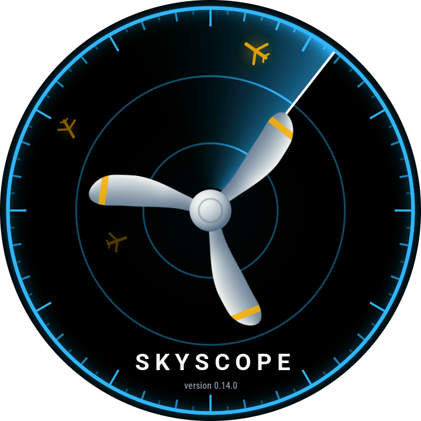 <b>At the start</b> The emblem, a radar scope whose beam is a propeller, turning to rest over the screen's name and version; on the round screen the scope's rim is the edge of the glass.</td>
<td width="33%" valign="top">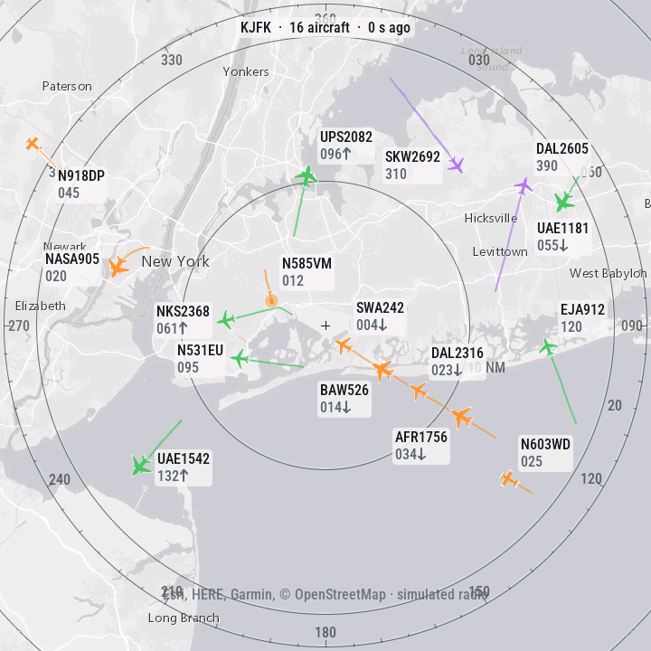 <b>Streets, light</b> Esri's light gray map with range rings and the compass rose, as a new screen starts. Arrivals line up on the final approach; each plane is drawn as what it is.</td>
<td width="33%" valign="top">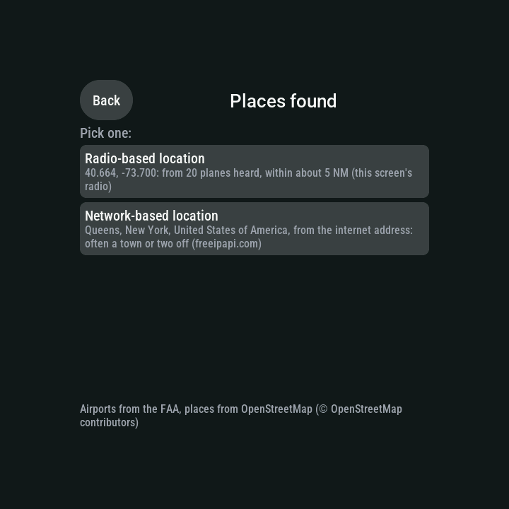 <b>Where is the screen?</b> Locate, under the place's field in the menu: where the planes the screen's own radio hears put it, and the town its internet address is in (asked only then); neither is used until it is picked.</td>
</tr>
<tr>
<td width="33%" valign="top">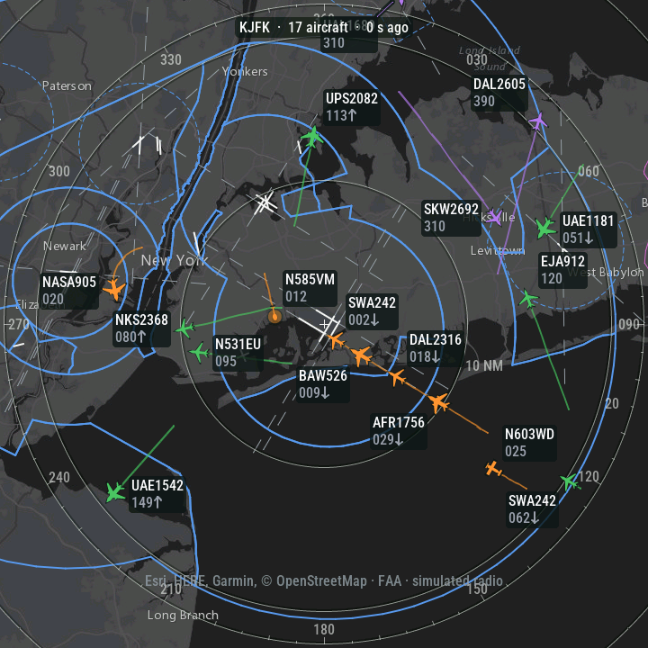 <b>Streets, dark, with airspace</b> The same map dark, with the FAA's Class B, C and D airspace and the runways' extended centerlines.</td>
<td width="33%" valign="top">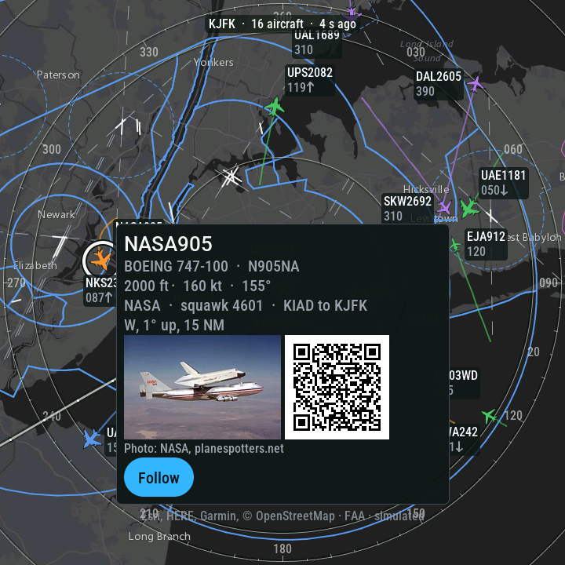 <b>A plane's card</b> Tap a plane: its type, registration, operator, altitude with the climb or descent, speed and squawk, its route (drawn on the map), which way to look for it, and its photo with a QR code to the photo's page. Here NASA's 747 with Enterprise on its back, circling the Statue of Liberty, and a NASA photo standing in for Planespotters.net's.</td>
<td width="33%" valign="top">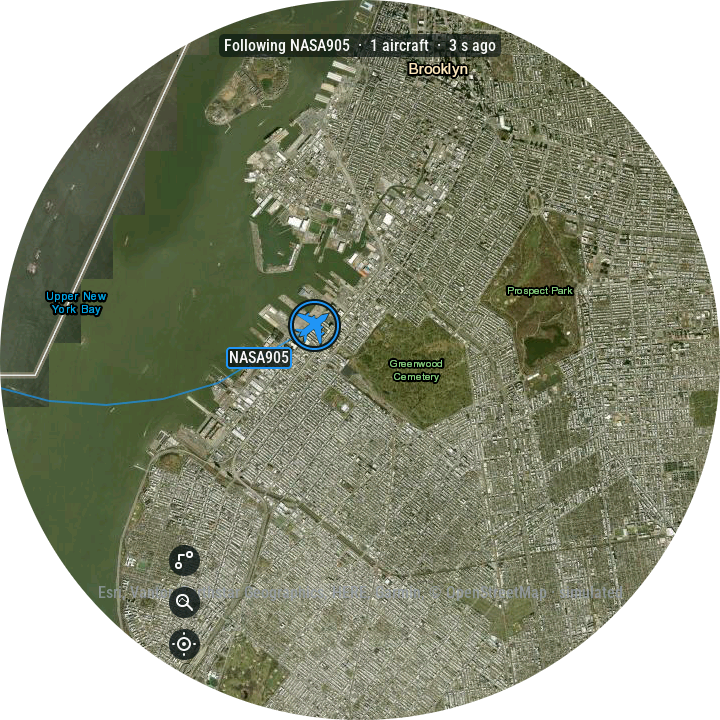 <b>Following a plane</b> The map moves with a plane followed, at a range for its speed, with its track since it was found and keys down the left edge for its route and the range. NASA 905 over the harbor on Esri's imagery.</td>
</tr>
<tr>
<td width="33%" valign="top">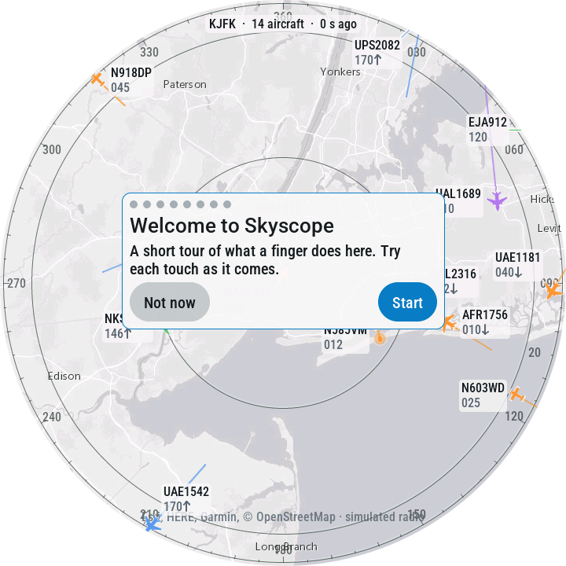 <b>The tour</b> A new screen's first map comes with a tour of what a finger does, one touch at a time.</td>
<td width="33%" valign="top">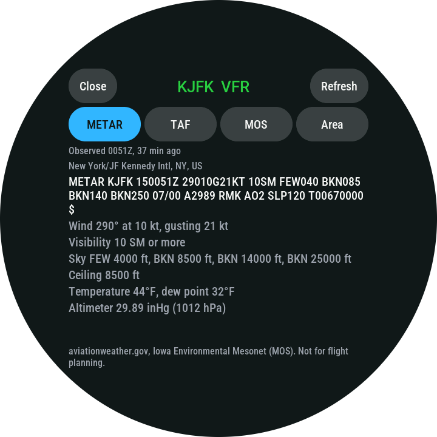 <b>Aviation weather</b> A swipe up from the bottom edge: the station's METAR, decoded, with its flight category in color; the TAF, MOS and advisories are a tab away.</td>
<td width="33%" valign="top">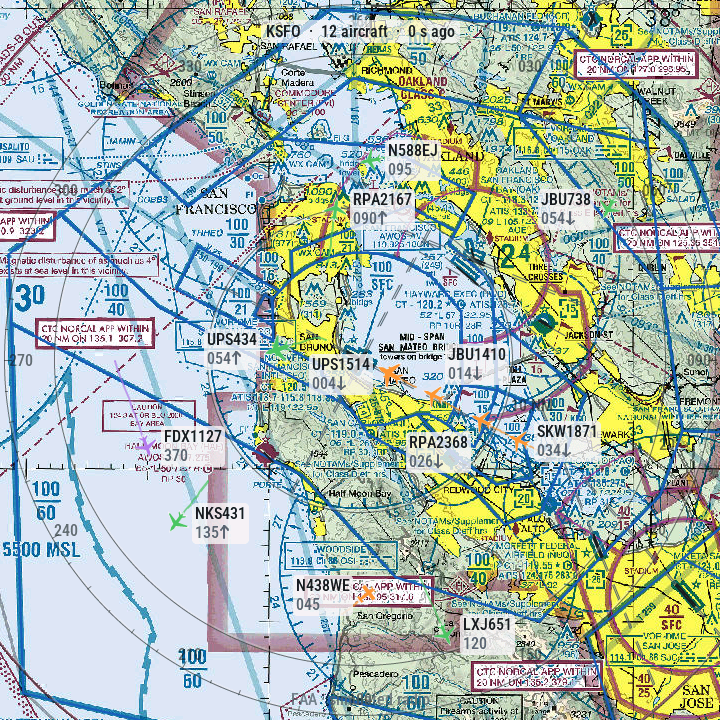 <b>VFR sectional</b> The FAA's sectional chart around San Francisco, with the Class B shelves over it.</td>
</tr>
<tr>
<td width="33%" valign="top">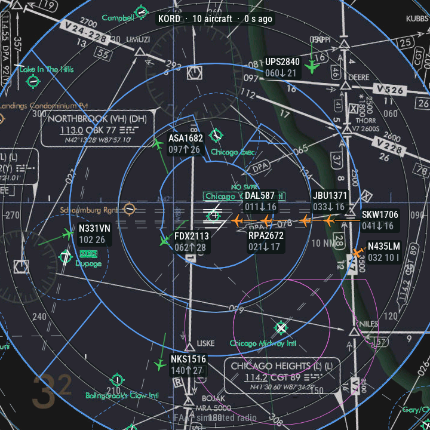 <b>IFR low, dark, with data blocks</b> The IFR enroute low chart made dark (its paper and ink turned around, its colors kept), and every label a controller's data block.</td>
<td width="33%" valign="top">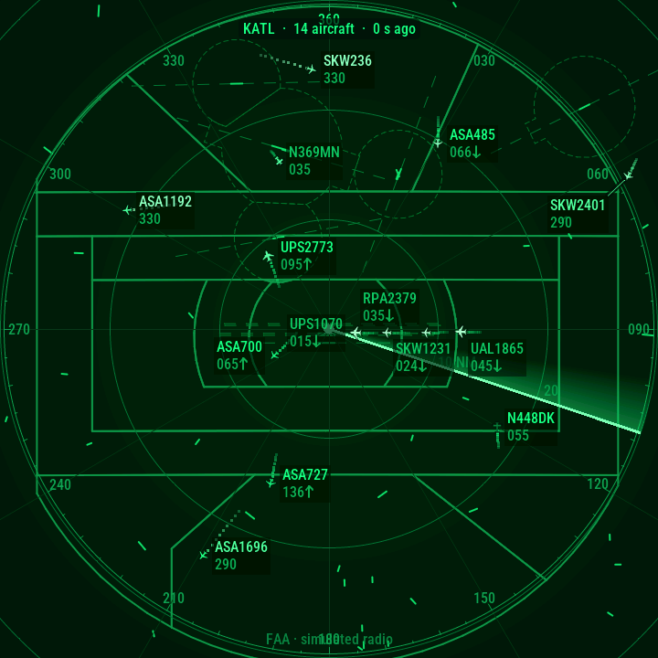 <b>Radar scope</b> The scope drawn on the screen itself, nothing downloaded: its glow, bearing lines and the beam painting the planes as it passes, with Atlanta's airspace in the phosphor.</td>
<td width="33%" valign="top">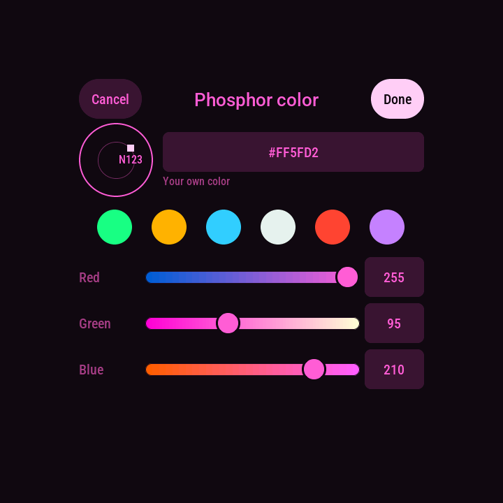 <b>The phosphor in any color</b> The menu's color picker: a swatch for each named phosphor, a slider for each of red, green and blue, and a small scope lit in the color.</td>
</tr>
<tr>
<td width="33%" valign="top">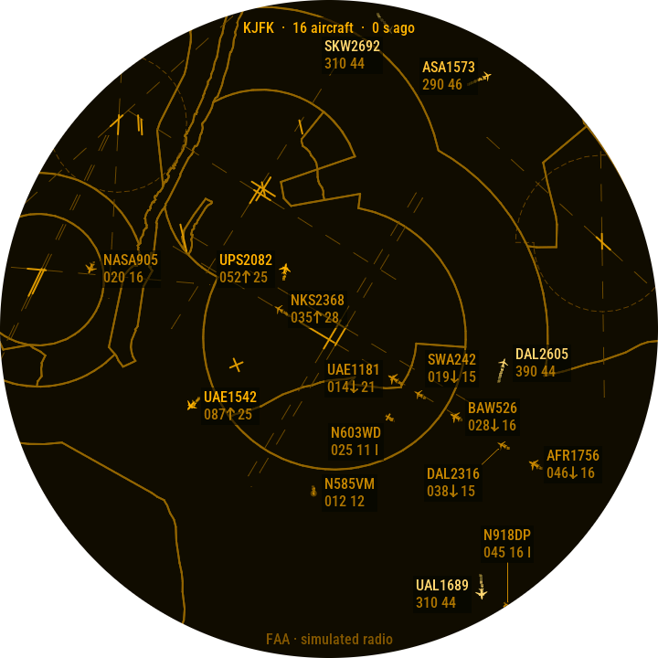 <b>A controller's bare map</b> The scope switched off: the planes, data blocks and airspace alone on the dark ground, in amber.</td>
<td width="33%" valign="top">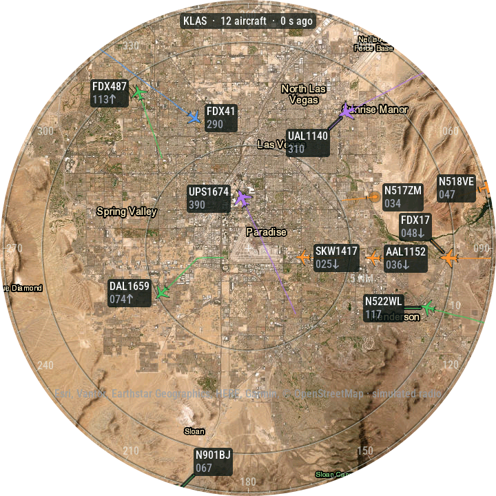 <b>Satellite</b> Esri's imagery of Las Vegas with its place names over it.</td>
<td width="33%" valign="top">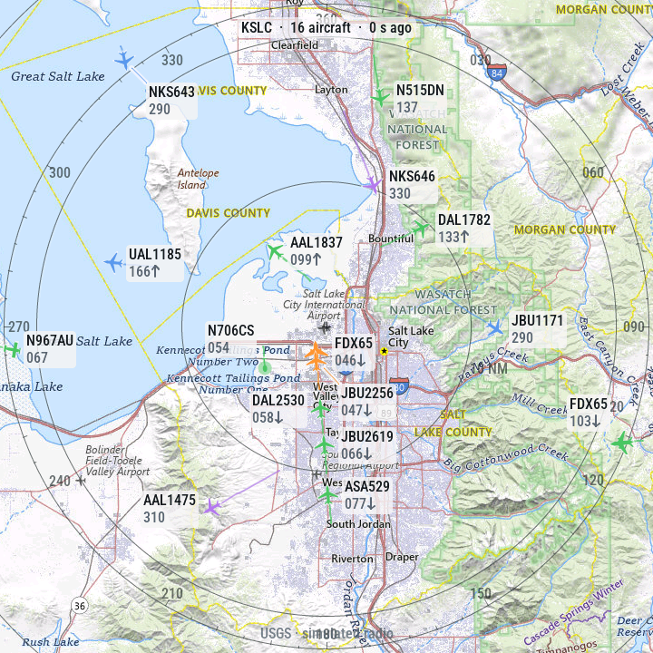 <b>USGS topo</b> The USGS topographic map around Salt Lake City, light.</td>
</tr>
<tr>
<td width="33%" valign="top">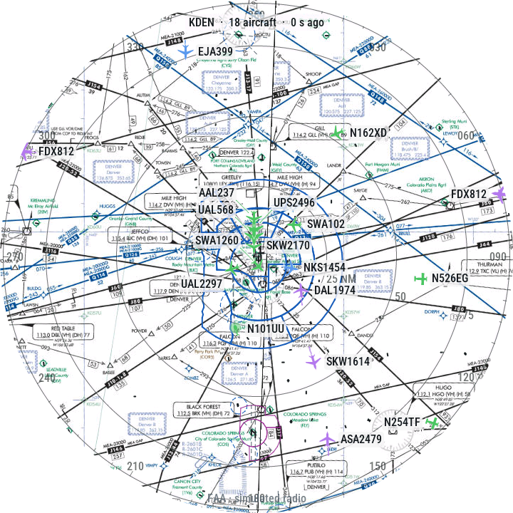 <b>IFR high enroute</b> The IFR high enroute chart at 80 NM, the jets passing over Denver.</td>
<td width="33%" valign="top">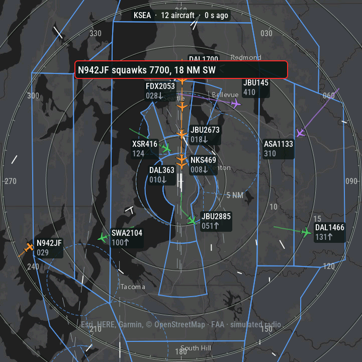 <b>An alert</b> A plane squawking 7700 in range shows along the top of the glass, its edge in the emergency's red; a tap on it opens the plane's card. A watched plane coming into range, or one passing close by, shows the same way.</td>
<td width="33%" valign="top">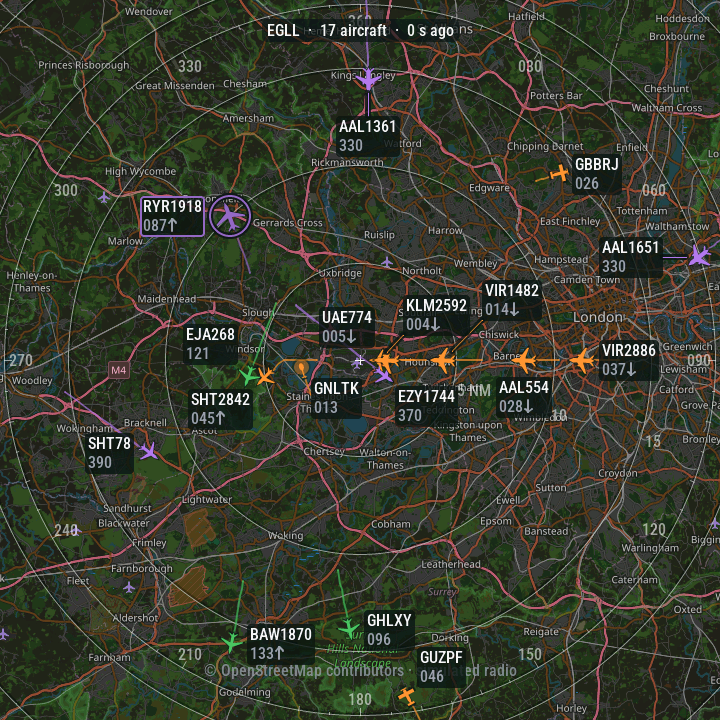 <b>OpenStreetMap, dark</b> OpenStreetMap around Heathrow, drawn dark with its hues kept, and a watched plane in a color of its own.</td>
</tr>
<tr>
<td width="33%" valign="top">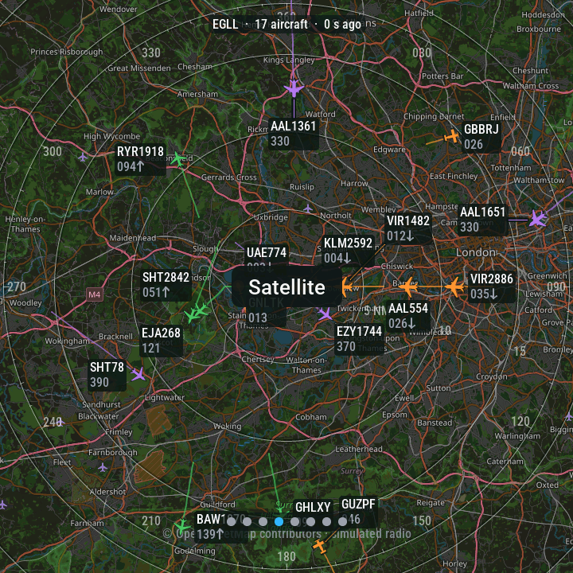 <b>Another map with a swipe</b> A swipe along the bottom edge goes to the next map, its name shown large with a dot for each; nothing is downloaded until the swipes stop.</td>
<td width="33%" valign="top">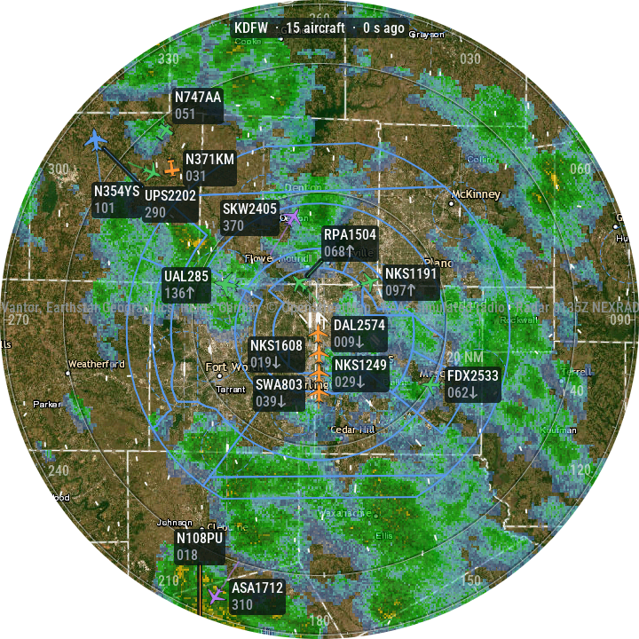 <b>Weather radar</b> The NEXRAD composite over the dark streets map, where it is raining now.</td>
<td width="33%" valign="top">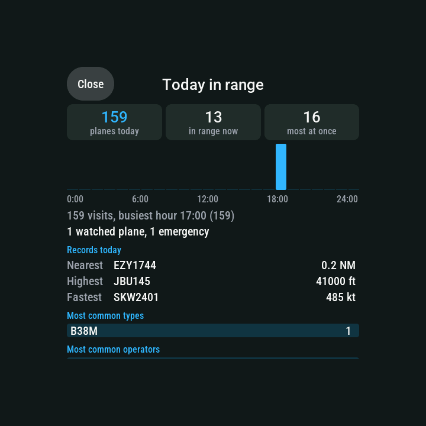 <b>Today's planes</b> A swipe down from the top edge: the planes seen in range today, in range now and the most at once, a bar for each hour, the day's records and its most common types and operators.</td>
</tr>
<tr>
<td width="33%" valign="top">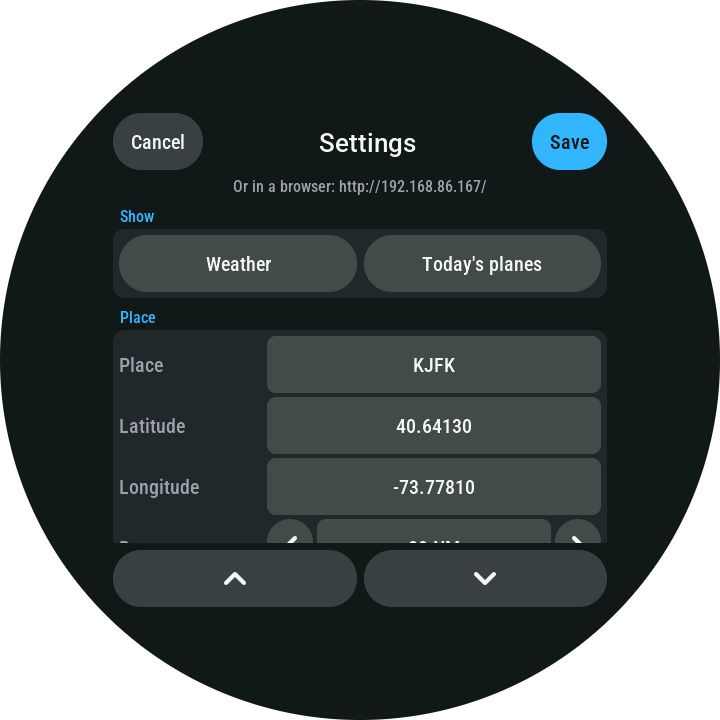 <b>The menu</b> A long press opens a menu with every setting the web page has; a tap on a value types it on a keyboard on the glass.</td>
<td width="33%" valign="top">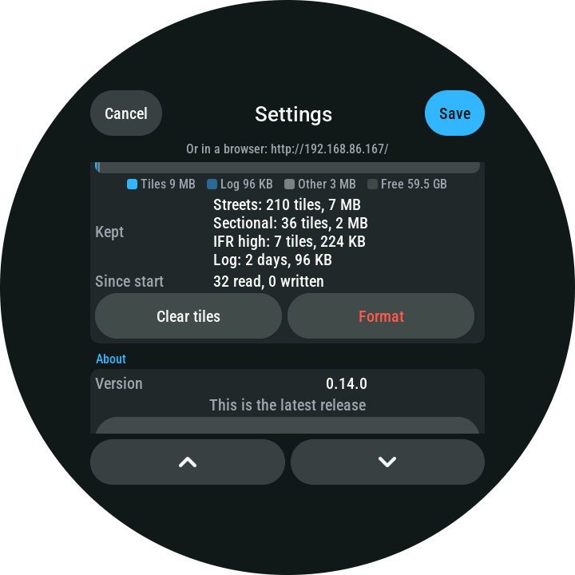 <b>The map card</b> With a microSD card in, every map tile is kept on it. The menu shows the card, its space and what the screen keeps on it, map by map.</td>
</tr>
</table>

## Waveshare AMOLED 2.41

Pictures of the 450 × 600 AMOLED.

<table>
<tr>
<td width="33%" valign="top">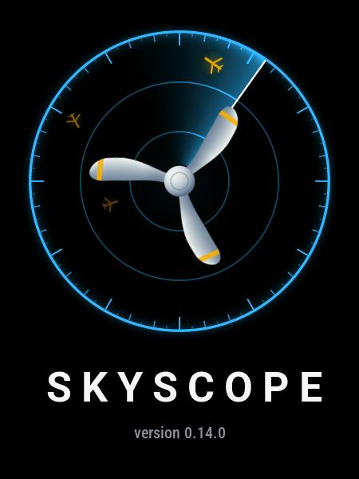 <b>At the start</b> The emblem, a radar scope whose beam is a propeller, turning to rest over the screen's name and version while it joins its network and fetches its map.</td>
<td width="33%" valign="top">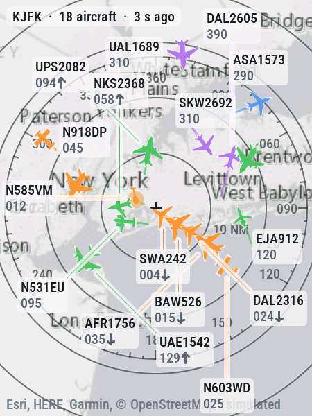 <b>Streets, light</b> Esri's light gray map with range rings and the compass rose, as a new screen starts. Arrivals line up on the final approach; each plane is drawn as what it is.</td>
<td width="33%" valign="top">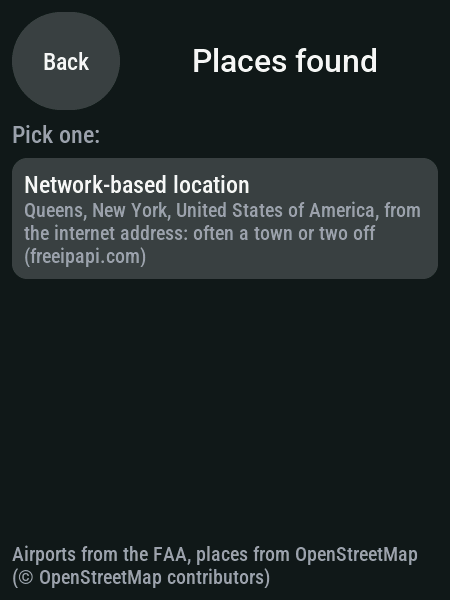 <b>Where is the screen?</b> Locate, under the place's field in the menu, offers the town the screen's internet address is in (asked only then); neither is used until it is picked.</td>
</tr>
<tr>
<td width="33%" valign="top">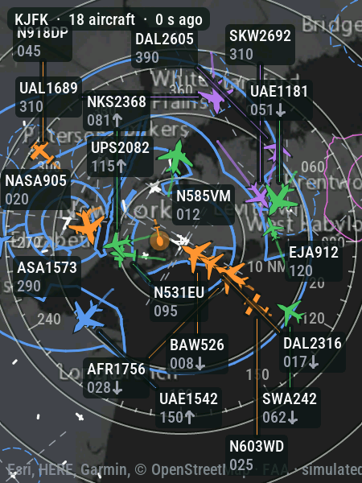 <b>Streets, dark, with airspace</b> The same map dark, with the FAA's Class B, C and D airspace and the runways' extended centerlines.</td>
<td width="33%" valign="top">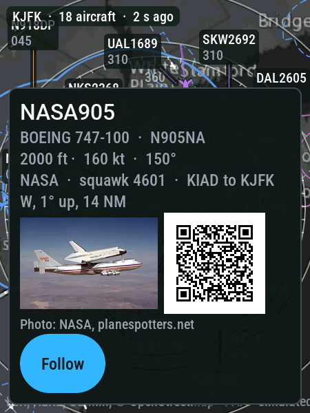 <b>A plane's card</b> Tap a plane: its type, registration, operator, altitude with the climb or descent, speed and squawk, its route (drawn on the map), which way to look for it, and its photo with a QR code to the photo's page. Here NASA's 747 with Enterprise on its back, circling the Statue of Liberty, and a NASA photo standing in for Planespotters.net's.</td>
<td width="33%" valign="top">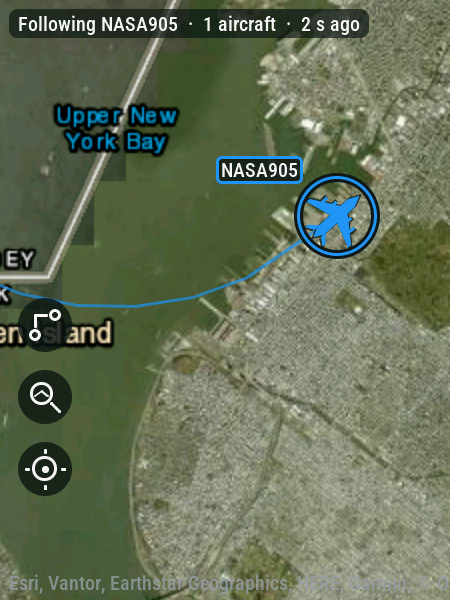 <b>Following a plane</b> The map moves with a plane followed, at a range for its speed, with its track since it was found and keys down the left edge for its route and the range. NASA 905 over the harbor on Esri's imagery.</td>
</tr>
<tr>
<td width="33%" valign="top">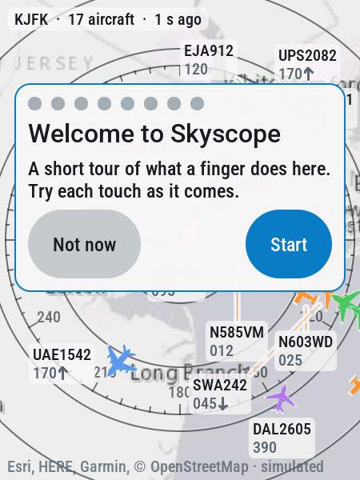 <b>The tour</b> A new screen's first map comes with a tour of what a finger does, one touch at a time.</td>
<td width="33%" valign="top">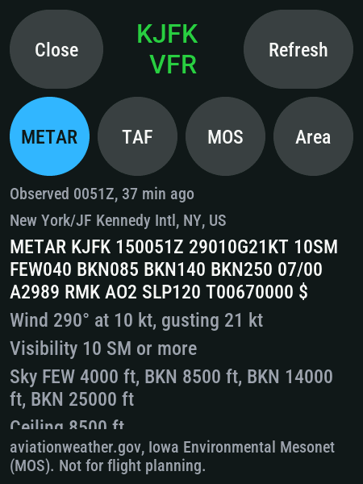 <b>Aviation weather</b> A swipe up from the bottom edge: the station's METAR, decoded, with its flight category in color; the TAF, MOS and advisories are a tab away.</td>
<td width="33%" valign="top">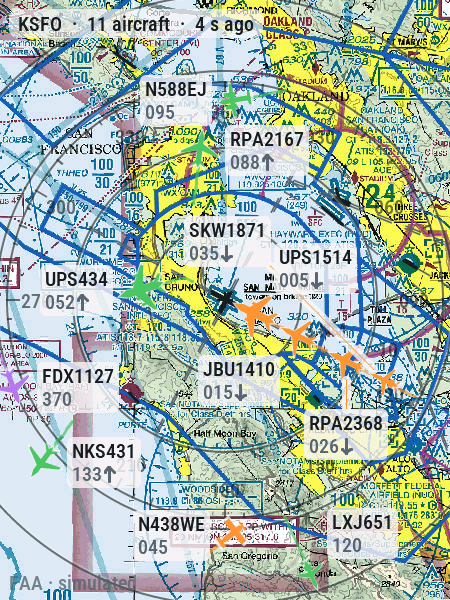 <b>VFR sectional</b> The FAA's sectional chart around San Francisco, with the Class B shelves over it.</td>
</tr>
<tr>
<td width="33%" valign="top">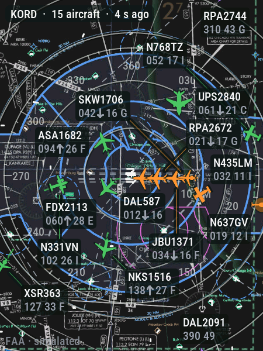 <b>IFR low, dark, with data blocks</b> The IFR enroute low chart made dark (its paper and ink turned around, its colors kept), and every label a controller's data block.</td>
<td width="33%" valign="top">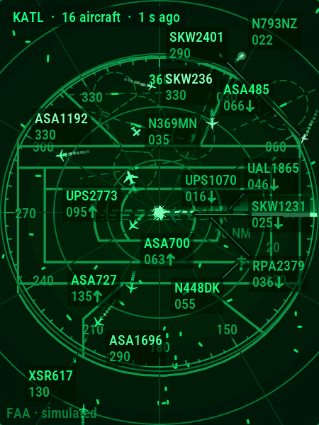 <b>Radar scope</b> The scope drawn on the screen itself, nothing downloaded: its glow, bearing lines and the beam painting the planes as it passes, with Atlanta's airspace in the phosphor.</td>
<td width="33%" valign="top">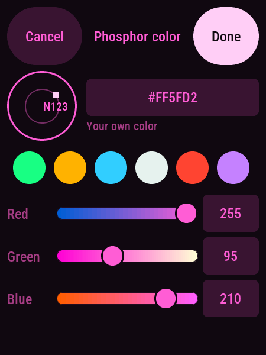 <b>The phosphor in any color</b> The menu's color picker: a swatch for each named phosphor, a slider for each of red, green and blue, and a small scope lit in the color.</td>
</tr>
<tr>
<td width="33%" valign="top">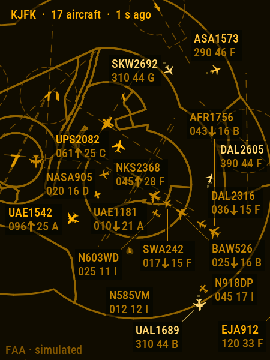 <b>A controller's bare map</b> The scope switched off: the planes, data blocks and airspace alone on the dark ground, in amber.</td>
<td width="33%" valign="top">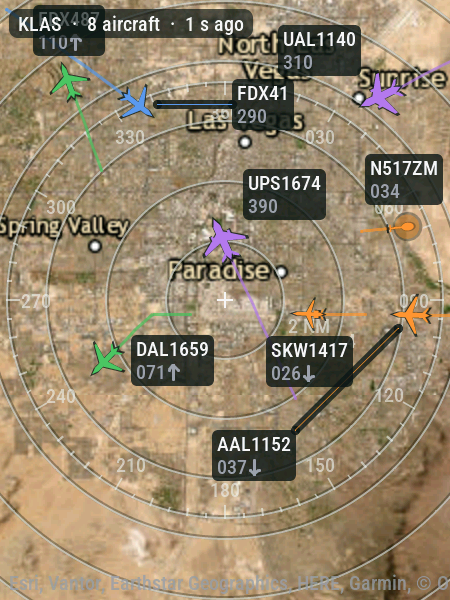 <b>Satellite</b> Esri's imagery of Las Vegas with its place names over it.</td>
<td width="33%" valign="top">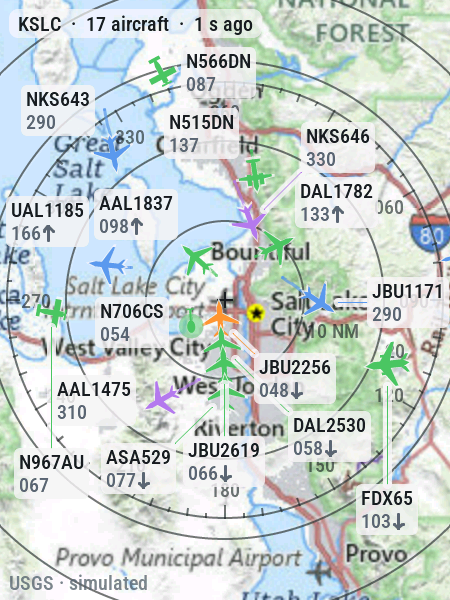 <b>USGS topo</b> The USGS topographic map around Salt Lake City, light.</td>
</tr>
<tr>
<td width="33%" valign="top">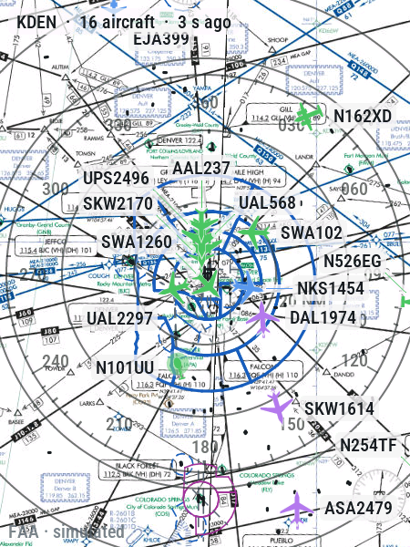 <b>IFR high enroute</b> The IFR high enroute chart at 80 NM, the jets passing over Denver.</td>
<td width="33%" valign="top">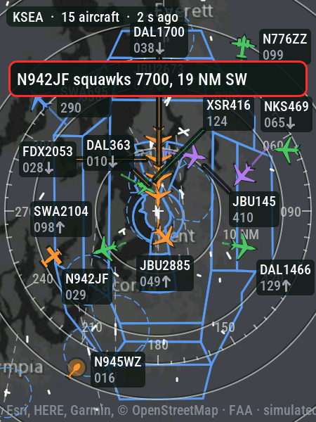 <b>An alert</b> A plane squawking 7700 in range shows along the top of the glass, its edge in the emergency's red; a tap on it opens the plane's card. A watched plane coming into range, or one passing close by, shows the same way.</td>
<td width="33%" valign="top">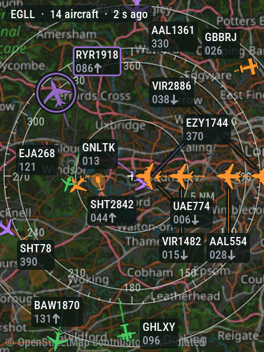 <b>OpenStreetMap, dark</b> OpenStreetMap around Heathrow, drawn dark with its hues kept, and a watched plane in a color of its own.</td>
</tr>
<tr>
<td width="33%" valign="top">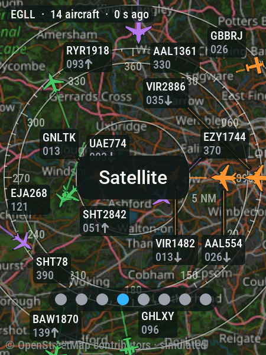 <b>Another map with a swipe</b> A swipe along the bottom edge goes to the next map, its name shown large with a dot for each; nothing is downloaded until the swipes stop.</td>
<td width="33%" valign="top">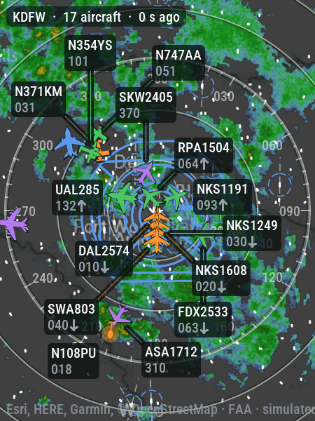 <b>Weather radar</b> The NEXRAD composite over the dark streets map, where it is raining now.</td>
<td width="33%" valign="top">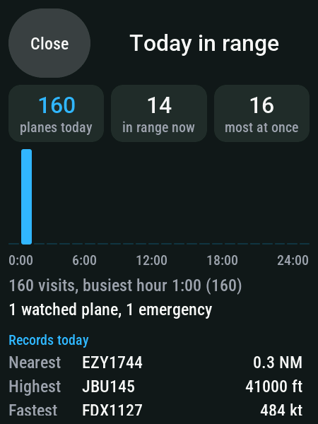 <b>Today's planes</b> A swipe down from the top edge: the planes seen in range today, in range now and the most at once, a bar for each hour, the day's records and its most common types and operators.</td>
</tr>
<tr>
<td width="33%" valign="top">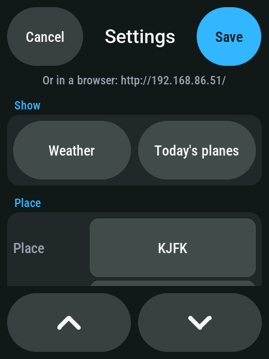 <b>The menu</b> A long press opens a menu with every setting the web page has; a tap on a value types it on a keyboard on the glass.</td>
</tr>
</table>
