# What the screen shows

Pictures of a Waveshare AMOLED 2.41 taken from the screen itself (`tools/screenshots.py`, which asks it for what its glass shows: `GET /api/screenshot`). The maps, airspace and weather are the real ones; the planes are made up, so no real flight is shown. Back to the [README](../README.md).

<table>
<tr>
<td width="33%" valign="top">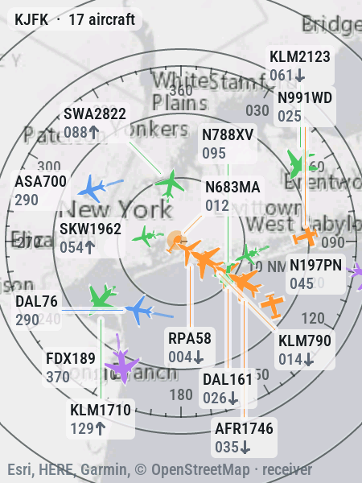 <b>Streets, light</b> Esri's light gray map with range rings and the compass rose, as a new screen starts. Arrivals line up on the final approach; each plane is drawn as what it is.</td>
<td width="33%" valign="top">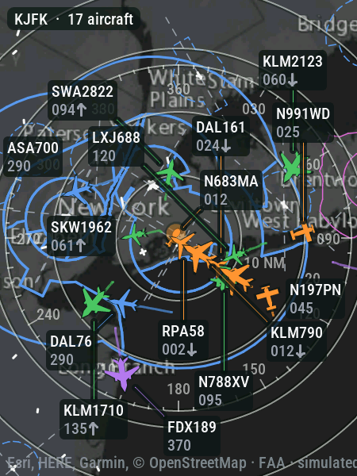 <b>Streets, dark, with airspace</b> The same map dark, with the FAA's Class B, C and D airspace and the runways' extended centerlines.</td>
<td width="33%" valign="top">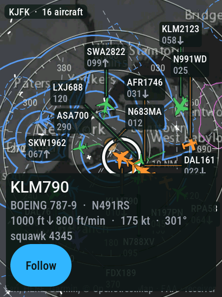 <b>A plane's card</b> Tap a plane: its type, registration, altitude with the climb or descent, speed, heading and squawk.</td>
</tr>
<tr>
<td width="33%" valign="top">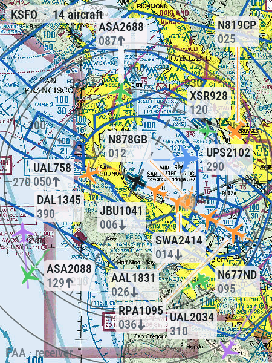 <b>VFR sectional</b> The FAA's sectional chart around San Francisco, with the Class B shelves over it.</td>
<td width="33%" valign="top">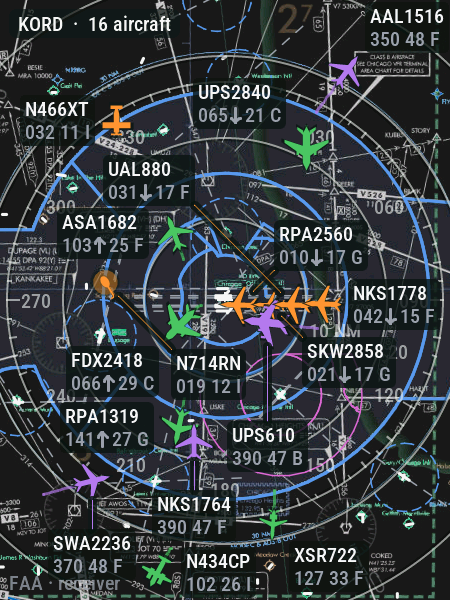 <b>IFR low, dark, with data blocks</b> The IFR enroute low chart made dark (its paper and ink turned around, its colors kept), and every label a controller's data block.</td>
<td width="33%" valign="top">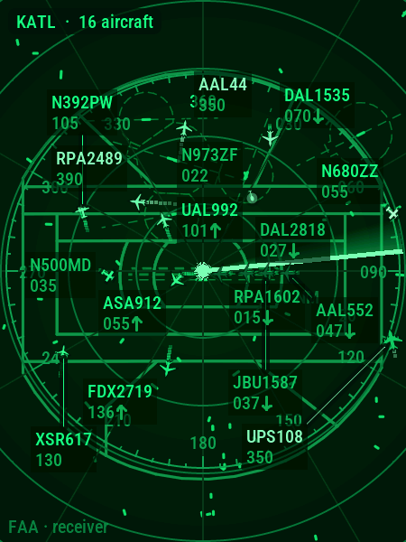 <b>Radar scope</b> The scope drawn on the screen itself, nothing downloaded: its glow, bearing lines and the beam painting the planes as it passes, with Atlanta's airspace in the phosphor.</td>
</tr>
<tr>
<td width="33%" valign="top">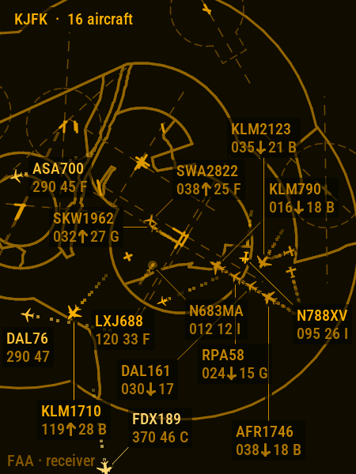 <b>A controller's bare map</b> The scope switched off: the planes, data blocks and airspace alone on the dark ground, in amber.</td>
<td width="33%" valign="top">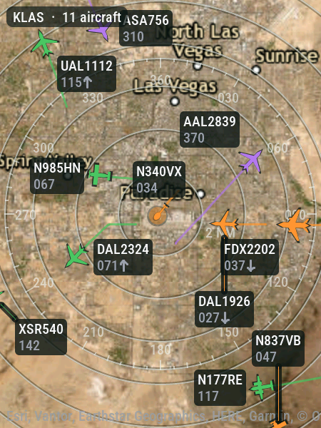 <b>Satellite</b> Esri's imagery of Las Vegas with its place names over it.</td>
<td width="33%" valign="top">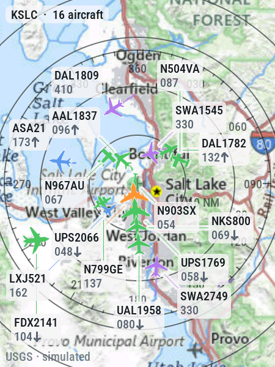 <b>USGS topo</b> The USGS topographic map around Salt Lake City, light.</td>
</tr>
<tr>
<td width="33%" valign="top">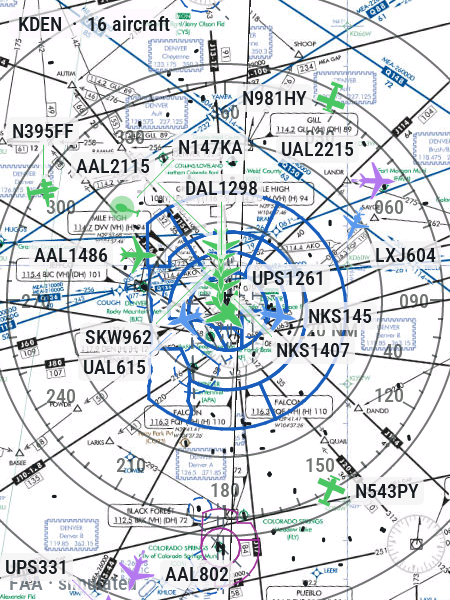 <b>IFR high enroute</b> The IFR high enroute chart at 80 NM, the jets passing over Denver.</td>
<td width="33%" valign="top">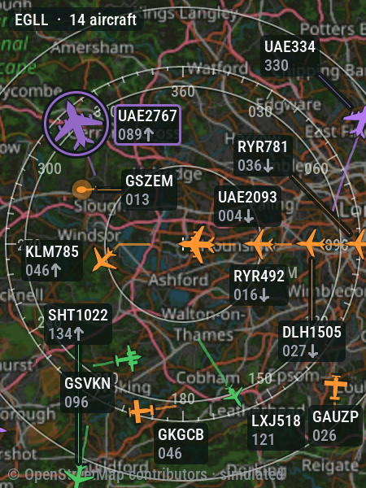 <b>OpenStreetMap, dark</b> OpenStreetMap around Heathrow, drawn dark with its hues kept, and a watched plane in a color of its own.</td>
<td width="33%" valign="top">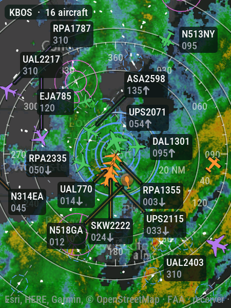 <b>Weather radar</b> The NEXRAD composite over the dark streets map, where it is raining now.</td>
</tr>
<tr>
<td width="33%" valign="top">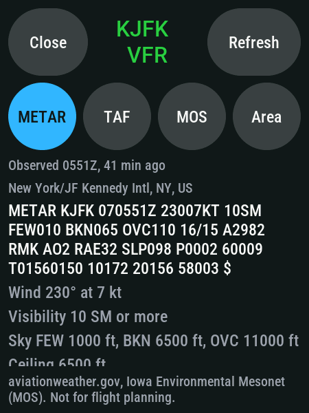 <b>Aviation weather</b> A swipe up from the bottom edge: the station's METAR, decoded, with its flight category in color; the TAF, MOS and advisories are a tab away.</td>
<td width="33%" valign="top">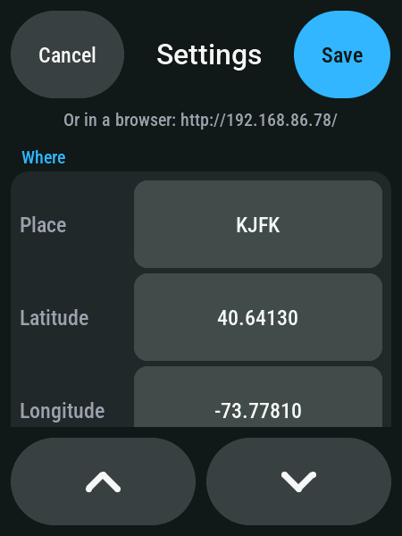 <b>The menu</b> A long press opens a menu with every setting the web page has; a tap on a value types it on a keyboard on the glass.</td>
</tr>
</table>
